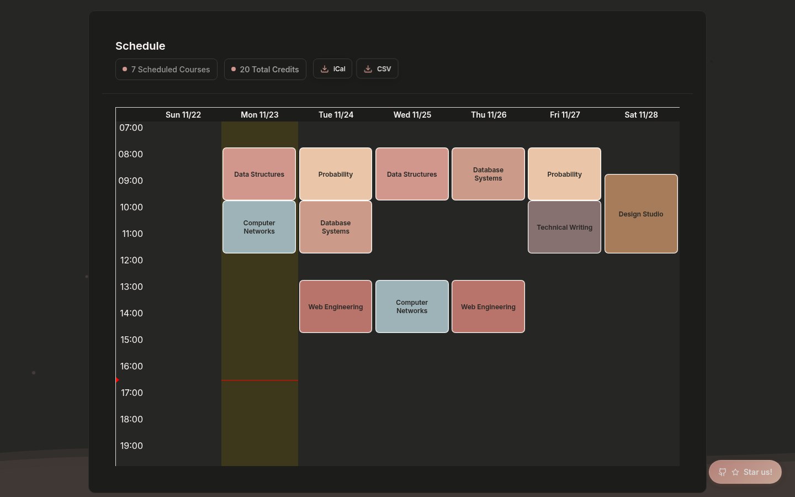
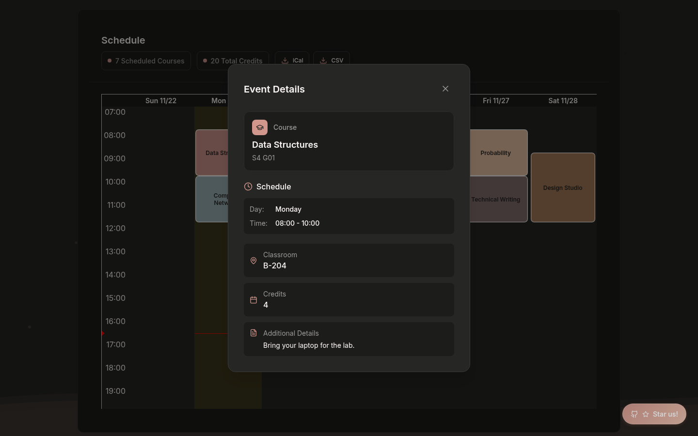
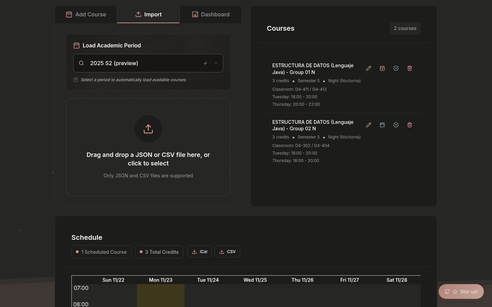
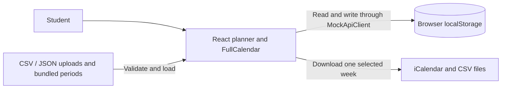

<!-- markdownlint-disable-next-line MD041 -->
<div align="center">

<h1>Vale</h1>

<p><strong>A weekly timetable planner for students comparing course sections.</strong></p>

<p>
<a href="https://github.com/diegnghtmr/vale/actions/workflows/ci.yml"></a>


<a href="LICENSE"></a>
</p>

<p>
<a href="https://diegnghtmr.me/en/work/vale/"><strong>Case study</strong></a> &bull;
<a href="#quick-start"><strong>Quick start</strong></a> &bull;
<a href="#architecture"><strong>Architecture</strong></a>
</p>

</div>

<p align="center"></p>

Course lists show times and sections, but they don't show how the week fits together. Vale (Versatile Academic Logistics Environment) lets you compare alternatives, add a section only when its meetings fit, and export your selected timetable. It keeps course data in your browser without a server or sign-in.

## Features

- **Course imports.** Add sections manually, import JSON or CSV using the bundled templates, or load a sample academic period.
- **Section filters.** Narrow the list by name, semester, shift, and credit range; use the course list to toggle sections onto the timetable.
- **Conflict checks.** Reject overlapping meetings before changing the selection and allow back-to-back classes.
- **Weekly calendar.** Select a meeting to see its section, time, room, credits, and notes; toast messages report actions and conflicts.
- **Calendar exports.** Download the selected week as iCalendar (`.ics`) for Google Calendar, Apple Calendar, or Outlook, or as CSV; exports do not create a semester-long recurring series.
- **Progress by subject.** Record completion and review subject and credit totals without counting alternative sections twice.
- **Browser preferences.** Switch between light and dark themes and English and Spanish; course data and preferences are stored locally rather than synchronized between devices.

## Preview



Selecting a meeting opens its details without leaving the week.



Load a bundled period, then compare matching sections in the course list.

## Quick start

Install Node.js **18+** and npm; CI uses Node.js **24**. No app environment variables or backend are needed.

```sh
git clone https://github.com/diegnghtmr/vale.git
cd vale
npm ci
npm run dev
```

Open the URL printed by Vite (normally `http://localhost:5173`). Start with **Course Details** or import from [CSV and JSON templates](docs/templates/) and [sample academic periods](docs/academic-periods/). Use **Export** after selecting the meetings you want to keep, or open the dashboard to track completed courses.

Build with `npm run build` and inspect the production output with `npm run preview`. The [Vercel configuration](vercel.json) supports static deployment. Use the [hosted app](https://vale-sage.vercel.app/) to try the planner without installing it.

## Architecture

The React app validates incoming files and generates exports entirely in the browser. `MockApiClient` implements the API contract with `localStorage`; exchanging it for another implementation of `ApiClient` is the integration point for a backend. The completion key normalizes the subject name, so sections share a status; distinct subjects with the same normalized name also share a status.



## Tech stack

| Layer | Technology |
| --- | --- |
| App and build | React 18, TypeScript 5, Vite 6 |
| Calendar and export | FullCalendar 6, `ics` |
| UI and localization | i18next, GSAP, react-hot-toast |
| Testing and style | Jest, Testing Library, ESLint, Prettier |

## Testing

```sh
npm test -- --runInBand
npm run build
npm run lint
npm run format:check
```

CI runs the Jest suite and production build after a lockfile install. Jest covers scheduling, subject keys, and credits. `npm run format` applies formatting to source files.

## Project structure

```text
src/components/  Calendar, course forms, and dashboard
src/context/     Theme and language providers
src/hooks/       Courses and UI state
src/locales/     English and Spanish translations
src/services/    Browser-backed API interface
src/utils/       Scheduling and import/export logic
public/          Static assets
docs/            Templates and sample periods
```

For extensions, see the [API adapter](src/services/api.ts), [theme definitions](src/data/themes.ts), and [translations](src/locales/). Report bugs or propose changes through GitHub issues and pull requests.

## License

[MIT](LICENSE).
